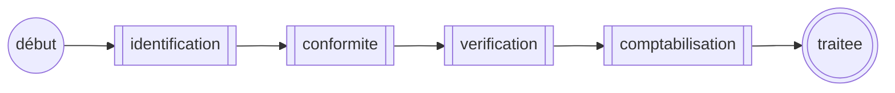
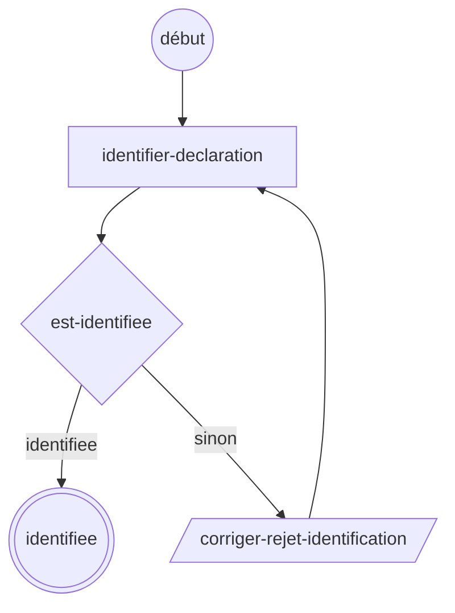
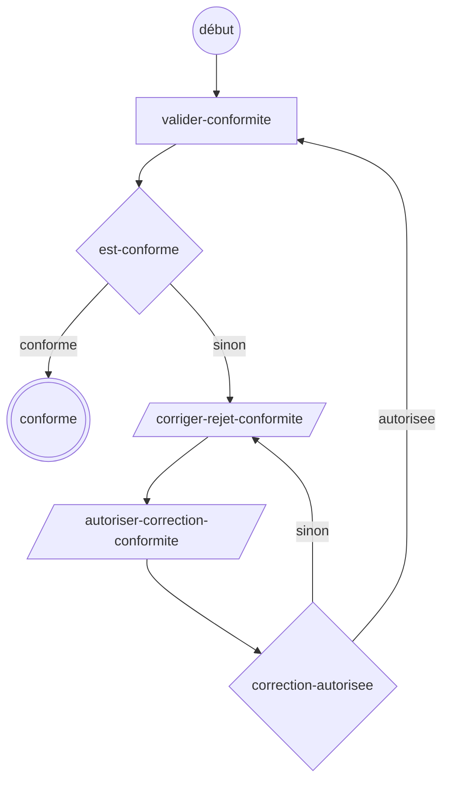
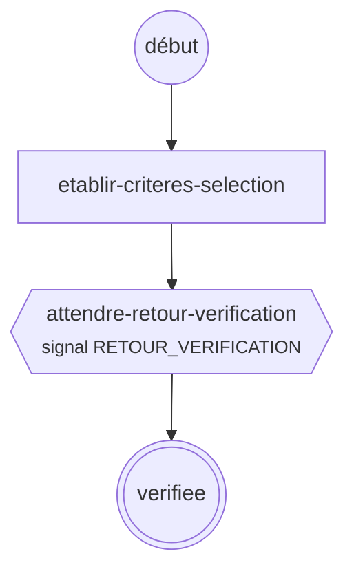
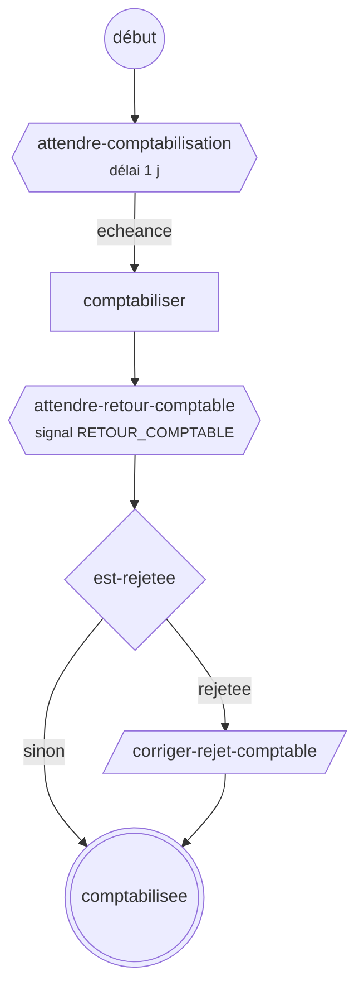

# Exemple : traitement d'une déclaration par sous-processus

Le traitement d'une déclaration est un processus parent composé uniquement de sous-processus : identification, conformité, vérification, puis comptabilisation. Il ne démarre qu'une fois la déclaration reçue et enregistrée par l'application.

```
dotnet run --project exemples/DeclarationSousProcessus
```

Le programme déroule une déclaration sur SQLite en mémoire en passant une fois par chaque correction, puis affiche l'historique de chaque instance et les diagrammes. Le projet n'est pas dans `Sentier.sln`.

| Fichier | Contenu |
|---|---|
| `TraitementDeclaration.cs`, `IdentificationDeclaration.cs`, `ConformiteDeclaration.cs`, `VerificationDeclaration.cs`, `ComptabilisationDeclaration.cs` | Définitions du parent et des quatre sous-processus |
| `IdentifierDeclaration.cs`, `ValiderConformite.cs`, `EtablirCriteresSelection.cs`, `Comptabiliser.cs` | Commandes : elles ne reçoivent que la clé d'affaire |
| `RequeteEtatDeclaration.cs`, `EstIdentifiee.cs`, `EstConforme.cs`, `CorrectionConformiteAutorisee.cs`, `EstRejeteeComptabilite.cs` | Requêtes, en lecture seule |
| `I*.cs`, `Declaration.cs`, `EtatDeclaration.cs` | Interfaces des services métier et état de la déclaration |
| `Simulateur.cs`, `HorlogeSimulee.cs`, `GestionnaireTachesMemoire.cs`, `Journal.cs` | Services simulés, horloge déplaçable, gestionnaire de tâches en mémoire (démonstration seulement) |
| `Programme.cs` | Scénario de démonstration |

## Démarrage

L'application enregistre la déclaration, puis démarre le traitement **dans la même transaction**, avec le numéro de la déclaration comme clé d'affaire. Aucune variable n'est passée :

```csharp
await dossiers.EnregistrerAsync(declaration, ct);
await sentier.DemarrerAsync("traitement-declaration", declaration.Numero);
```

## Sans variables

Aucun des processus ne déclare de variable. Chaque sous-processus démarre sur la clé d'affaire du parent (le défaut), et :

- les **commandes** passent la clé d'affaire (`contexte.CleAffaire`) au service métier, qui tient le résultat dans le dossier de la déclaration ;
- les **requêtes** des décisions lisent l'état de la déclaration (`IDossiersDeclarations.ObtenirEtatAsync`) ;
- les **tâches** ne portent aucune donnée : la correction ou l'autorisation est saisie dans l'écran de l'application, qui complète ensuite la tâche ;
- les **signaux** visent le sous-processus et la clé d'affaire ; l'application enregistre d'abord la réponse du système externe dans le dossier.

## Processus parent : `traitement-declaration`



Le parent attend la fin de chaque enfant sur son nœud sous-processus. Un enfant annulé annule le parent.

## Sous-processus

### Identification : `identification-declaration`



### Conformité : `conformite-declaration`

Comme l'identification, avec une autorisation après la correction. Une correction refusée retourne en correction ; chaque validation remet l'autorisation à faux.



### Vérification : `verification-declaration`



### Comptabilisation : `comptabilisation-declaration`



| Sous-processus | Nœud | Rôle |
|---|---|---|
| Identification | `identifier-declaration` → `est-identifiee` | système |
| | `corriger-rejet-identification`, puis nouvelle identification | `agent-identification` |
| Conformité | `valider-conformite` → `est-conforme` | système |
| | `corriger-rejet-conformite` | `agent-conformite` |
| | `autoriser-correction-conformite` → `correction-autorisee` | `chef-equipe-conformite` |
| Vérification | `etablir-criteres-selection` | système |
| | `attendre-retour-verification` : signal `RETOUR_VERIFICATION` | système de vérification |
| Comptabilisation | `attendre-comptabilisation` : délai avant le traitement comptable | système |
| | `comptabiliser`, puis `attendre-retour-comptable` : signal `RETOUR_COMPTABLE` | système comptable |
| | `est-rejetee` → `corriger-rejet-comptable`, puis fin | `agent-comptable` |

## Intégration

- **Tâches** : elles sont portées par l'instance du sous-processus actif. Pour retrouver la tâche d'une déclaration, chercher par clé d'affaire :

  ```csharp
  var instances = await suivi.ObtenirInstancesParCleAffaireAsync(numeroDeclaration,
      ["identification-declaration", "conformite-declaration", "comptabilisation-declaration"], [StatutInstance.Suspendue]);
  var idTache = instances.Single(i => i.IdTacheCourante is not null).IdTacheCourante!.Value;
  await sentier.CompleterTacheAsync(idTache, utilisateur: "agent");
  ```

- **Retours des systèmes externes** : le service qui reçoit la réponse l'enregistre dans le dossier, puis envoie le signal au sous-processus, dans la même transaction :

  ```csharp
  await sentier.EnvoyerSignalAsync(VerificationDeclaration.SignalRetourVerification, "verification-declaration", numeroDeclaration);
  await sentier.EnvoyerSignalAsync(ComptabilisationDeclaration.SignalRetourComptable, "comptabilisation-declaration", numeroDeclaration);
  ```

- **Délai de comptabilisation** : un traitement planifié appelle `ObtenirEcheancesDuesAsync` puis `TraiterEcheanceAsync` pour chaque échéance due. Pour suivre un calendrier comptable plutôt qu'un délai fixe, il faudrait une variable date calculée par une commande d'entrée (`Echeance(variable)`).
