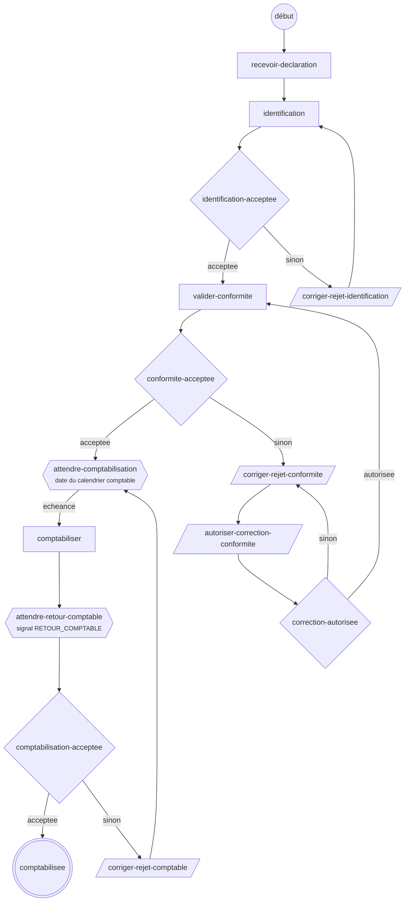

# Exemple : traitement d'une déclaration

Processus long, de la réception d'une déclaration jusqu'à sa comptabilisation, avec trois boucles de correction, une attente sur le calendrier comptable et une attente du retour comptable.

```
dotnet run --project exemples/TraitementDeclaration
```

Le programme déroule une déclaration sur SQLite en mémoire en passant une fois par chaque correction, puis affiche l'historique et le diagramme. Le projet n'est pas dans `Sentier.sln`.

| Fichier | Contenu |
|---|---|
| `TraitementDeclaration.cs` | Définition du processus et ses variables |
| `Commandes.cs` | Commandes et requêtes, avec leurs paramètres typés |
| `Services.cs` | Interfaces des services métier appelés par les commandes |
| `Simulation.cs` | Services simulés, horloge déplaçable, gestionnaire de tâches en mémoire (démonstration seulement) |
| `Programme.cs` | Scénario de démonstration |

## Déroulement



| Étape | Nœud | Rôle |
|---|---|---|
| Réception de la déclaration | `recevoir-declaration` | système |
| Identification | `identification` → `identification-acceptee` | système |
| Correction du rejet d'identification | `corriger-rejet-identification`, puis retour à l'identification | `agent-identification` |
| Validation de conformité | `valider-conformite` → `conformite-acceptee` | système |
| Correction du rejet de conformité | `corriger-rejet-conformite` | `agent-conformite` |
| Autorisation de la correction | `autoriser-correction-conformite` → `correction-autorisee` : autorisée → revalidation ; refusée → nouvelle correction | `chef-equipe-conformite` |
| Attente de comptabilisation | `attendre-comptabilisation` : échéance à la prochaine date du calendrier comptable | système |
| Comptabilisation | `comptabiliser` : transmet les écritures et retient le numéro de lot | système |
| Attente du retour comptable | `attendre-retour-comptable` : signal `RETOUR_COMPTABLE` corrélé au numéro de lot | système comptable |
| Aiguillage | `comptabilisation-acceptee` : sans rejet → fin `comptabilisee` ; sinon → correction | système |
| Correction du rejet comptable | `corriger-rejet-comptable`, puis retour en attente de comptabilisation | `agent-comptable` |

## Paramètres et variables

Démarrage, avec le numéro de déclaration comme clé d'affaire :

```csharp
await sentier.DemarrerAsync("traitement-declaration", numeroDeclaration, ValeursVariables
    .Avec(TraitementDeclaration.NumeroPeriode, "2026-02")
    .Et(TraitementDeclaration.TypeDeclaration, "ORIGINALE")
    .Et(TraitementDeclaration.MontantDeclare, 1205.00m));
```

| Variable | Type | Alimentée par |
|---|---|---|
| `numeroPeriode`, `typeDeclaration`, `montantDeclare` | texte, texte, décimal | démarrage (obligatoires) ; le montant peut être corrigé par la tâche de correction de conformité |
| `noIdentification` | entier | `IdentifierDeclarant` |
| `codeRejetIdentification`, `codeRejetConformite` | texte | `IdentifierDeclarant`, `ValiderConformite` (vide si accepté) |
| `correctionAutorisee` | booléen | tâche d'autorisation ; remis à faux à chaque validation de conformité |
| `dateComptabilisation` | date | `CalculerDateComptabilisation`, à chaque entrée dans l'attente |
| `noLotComptable` | texte | `Comptabiliser` ; sert de corrélation au signal de retour |
| `codeRejetComptable` | texte | charge utile du signal `RETOUR_COMPTABLE` ; effacé à chaque comptabilisation |

Chaque commande déclare ses paramètres dans la définition et les reçoit dans une classe typée, liée par nom :

```csharp
.Systemique<ValiderConformite>("valider-conformite", p => p
    .CleAffaire("numeroDeclaration")
    .Variables(NoIdentification, TypeDeclaration, MontantDeclare)
    .Valeur("toleranceEcart", 0.01m))
```

Les décisions lisent le code de rejet avec `VariableOptionnelle` : une variable vide est permise et signifie « accepté ».

## Intégration

- **Calendrier comptable** : la commande d'entrée de l'attente calcule `dateComptabilisation` par `ICalendrierComptable`. Un traitement planifié appelle `ObtenirEcheancesDuesAsync` puis `TraiterEcheanceAsync` pour chaque échéance due.
- **Retour comptable** : le système comptable, ou le service qui reçoit sa réponse, envoie le signal avec le numéro de lot :

  ```csharp
  await sentier.EnvoyerSignalCorrelationAsync(TraitementDeclaration.SignalRetourComptable, noLot,
      new Dictionary<string, object?> { ["codeRejetComptable"] = codeRejet });   // null si accepté
  ```

  Un retour pour un ancien lot, après une correction, ne trouve aucune attente et reste sans effet.
- **Tâches** : les nœuds interactifs passent par le `IGestionnaireTaches` de l'application. Les données saisies à la complétion (`montantDeclare`, `correctionAutorisee`…) sont fusionnées dans les variables du même nom.
